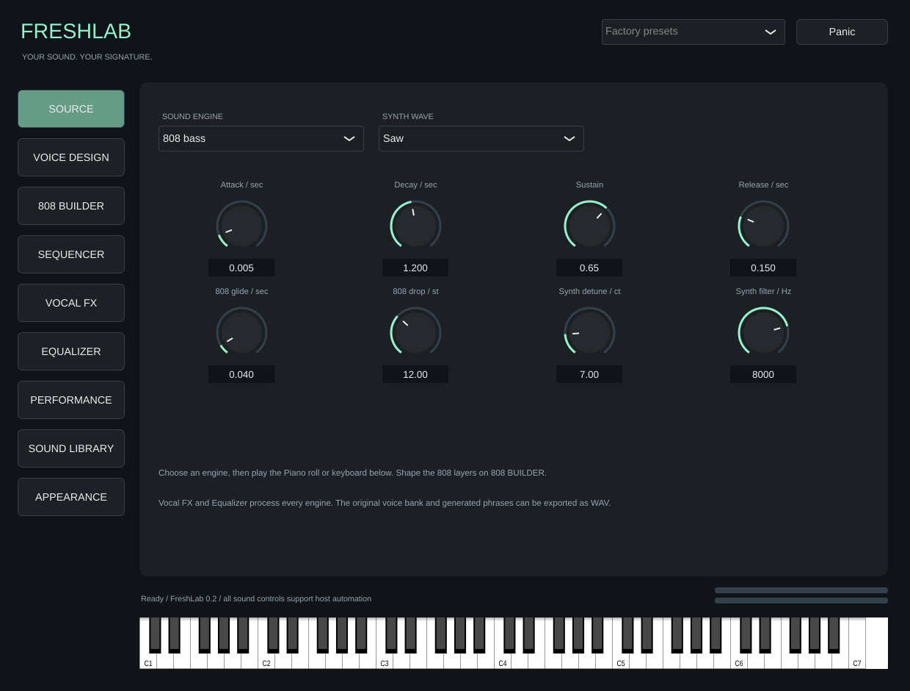

# FreshLab 0.2.0

An expanded source prototype of an FL Studio instrument and mixer-effects
suite for Windows and Mac. This update implements all nine customization
areas requested: voice design, type-to-adlib, sequencing, layered 808s,
vocal doubling/harmony, dynamic EQ, performance pads, a personal sound
library, and custom appearance.

**Delivery status:** Windows x64 compilation, all four test suites and native
packaging passed in [GitHub Actions](https://github.com/Doughboyfressh/freshlab/actions).
The first Mac universal build compiled but failed two float-equality assertions;
the recall tests now allow small normalization rounding differences. Check
Actions for the latest results and downloadable native packages. Actual FL
Studio host validation remains outstanding. The supplied WAVs can be used
immediately in FL Studio without compiling anything.

## Previews



[All nine instrument pages and four FX pages](docs/ui/README.md) are software
renders of the actual JUCE editors. Audio downloads:

- [Voice preview](docs/voice-preview.wav): eight typed phrases, then all 24 original adlibs.
- [808 and synth preview](docs/dsp-preview.wav): 12 seconds rendered by the DSP test tool.

Native packages include a `Previews/` folder. Each successful CI run also
uploads `FreshLab-previews-Windows` and `FreshLab-previews-macOS` artifacts.

## What's included

| Page | Controls and behavior |
| --- | --- |
| SOURCE | Mono 808, 16-voice synth, adlib sampler; envelope, glide, detune, four waveforms, low-pass tone control |
| VOICE DESIGN | Type up to 100 English characters; choose Sub/Spark/Haze/Circuit; set pitch, formant, breath, grit, robot texture, speed, stereo spread; generate and export stereo WAV |
| 808 BUILDER | Separate sub, punch, click and buzz levels; 808 saturation; draw eight pitch points over an adjustable time span |
| SEQUENCER | 16 steps, 4/8/16-step patterns, eighth/sixteenth/thirty-second notes, swing, per-step velocity and pitch, double/triple repeats, reverse, echo throws; host-synced or internal tempo |
| VOCAL FX | Compressor, de esser, distortion, delay, room, stereo doubler, editable harmony interval from -12 to +12 semitones, stereo width |
| EQUALIZER | High pass, low shelf, two parametric mid bands and high shelf; dynamic band with center, Q, threshold and maximum reduction; static response and dynamic reduction meter |
| PERFORMANCE | Eight clickable/MIDI pads, each with an engine, MIDI pitch, original/custom voice and Clean/Drive/Echo/Space combination |
| SOUND LIBRARY | Save/load complete patches, individual voices, instruments, EQs, or effects chains; import portable .freshlab files |
| APPEARANCE | Your plugin name and tagline, arbitrary accent color, three backgrounds, three knob styles, optional animated meters, imported PNG/JPEG logo |

Both plugins include the same mixer-effects rack. **FreshLab** is the
instrument. **FreshLab FX** is the insert for existing audio. Instrument-only
pages are disabled in the FX plugin.

## Original voices and usage rights

There are 24 built-in electronic adlibs in `Voices/` and eight examples of
the new typed-phrase engine in `Examples/Voices/`. The original sounds were
created specifically for this project using oscillators, noise and formant
resonators. No human recordings, speaker models, downloaded audio, or
external speech service are used by the generators.

The original WAVs, audio previews and original output of the built-in speech
synthesizer are dedicated under **CC0 1.0** to the extent rights exist. Edit,
sample, share, sell or release them commercially without attribution or
royalties. They are nonexclusive. See `Voices/VOICE-LICENSE.txt` and the full
CC0 legal code included alongside it. Imported recordings retain their own
rights; software dependency licenses are separate.

The speech engine is **stylized rule-based English formant synthesis**. Its
pronunciation is approximate and electronic, especially for unfamiliar names
or unusual spelling. It does not provide neural/natural speech, voice
cloning or arbitrary-language pronunciation.

`docs/voice-preview.wav` plays the eight typed examples first, then the
original 24-adlib bank. `Examples/Voices/manifest.json` records the typed
phrases and design settings. `Voices/manifest.json` describes the original
bank. Drag any WAV into FL Studio Sampler or the Playlist to use it now.

## Build on Windows

Install Visual Studio 2022 with **Desktop development with C++**, plus
CMake 3.24 or newer. Open PowerShell in this source folder:

```powershell
powershell -ExecutionPolicy Bypass -File .\scripts\build-windows.ps1
```

The first configure downloads official JUCE 8.0.12 and verifies the pinned
SHA-256. Copy both **entire** `.vst3` bundles from:

```text
build/FreshLab_artefacts/Release/VST3/
build/FreshLabFX_artefacts/Release/VST3/
```

into `C:\Program Files\Common Files\VST3`. Copying there may need
administrator permission. Do not copy just the DLL from inside a bundle.

## Build on Mac

Install Xcode with command-line tools and CMake 3.24 or newer:

```bash
bash scripts/build-macos.sh
```

This requests universal Intel/Apple Silicon VST3, AU and standalone builds
with a macOS 11 deployment target. Copy both entire `.vst3` bundles from the
same build paths above into `~/Library/Audio/Plug-Ins/VST3`. Create that
folder if needed. The build scripts do not provision signing or notarization.

`.github/workflows/build.yml` builds and tests Windows x64 and universal Mac
targets on GitHub Actions. After a successful run, its Artifacts section has
`FreshLab-Windows` and `FreshLab-macOS` downloads containing complete VST3
bundles, standalone apps, Mac Audio Units, the voice bank, and matching source.
These are unsigned development packages; native build results are visible in
[Actions](https://github.com/Doughboyfressh/freshlab/actions).
See `docs/INSTALL.md` for installation and the FL Studio test checklist.

## Load in FL Studio

1. Open **Options > Manage plugins** and find installed plugins with
   verification enabled.
2. Add **FreshLab** to the Channel rack for instruments, or **FreshLab FX** to
   a Mixer insert for recordings.
3. Select an engine on SOURCE and sequence it in the Piano roll.
4. Save the FL Studio project to retain all parameters, the current voice
   sample, the pattern, pad settings and appearance. Imported/generated
   current voices are embedded; their original file paths are not required.

The plugin's scan names and identity remain FreshLab / FreshLab FX even if
you change the displayed branding.

## Design a voice

1. On VOICE DESIGN, enter a voice name and a short English phrase.
2. Set the character and design knobs, then click **Generate phrase**.
3. Use **Play voice** to audition it. Export the generated sample with
   **Export WAV**. Design changes take effect when Generate is clicked again.
4. Playback pitch, root, start, reverse and one-shot operate on the current
   sample immediately. Root defaults to MIDI 60 / C4; FL may label that C5.
5. Export writes the current source sample, including generated design
   effects. Playback transposition/reverse and the mixer-effects rack are not
   baked into that export; record/render the plugin in FL for processed audio.

Generation and sample replacement happen outside the audio callback. Choose
or generate voices between takes: sample/state replacement can briefly
silence active playback. A generated phrase is limited to 12 seconds;
shorten the text or increase Speech speed if it exceeds the limit.

## Sequence and perform

Enable **Run pattern** on SEQUENCER. With **Follow FL transport** checked,
FL Studio must be playing and provide musical position; tempo and position
come from the host. Turn it off for the internal clock. Each step cycles
through Off, Hit, Double, Triple, Reverse and Echo. Its upper slider is pitch
in semitones; the lower slider is velocity. Sequencer output uses the current
custom voice and plays independently of the main instrument.

On PERFORMANCE, click a pad or enable MIDI notes 36-43 to route those notes
to the pads. The pad's note slider sets the resulting sound's pitch. MIDI
velocity controls hit strength. Voice choices apply when the pad engine is
Voice. UI synth-pad hits release after half a second; MIDI note-offs can
release them earlier. 808s decay and one-shot voices finish normally.

Drive/Echo/Space temporarily raise the shared effects-rack settings for two
seconds. The most recent pad combination wins. An Echo sequence step adds
a one-beat delay throw. **Panic** stops voices and clears effect tails.

## Save personal sounds

SOUND LIBRARY stores `.freshlab` files under the current account's application
support directory, in `FreshLab/Sounds/` with category subfolders. Saving the
same name creates another entry instead of overwriting an existing file.

- Complete sounds retain voices, instrument, pattern, pads, effects and brand.
- Voice entries embed their audio and design/playback controls. Loading one
  selects Adlib and preserves EQ/effects.
- Instrument entries restore source/envelope/808 settings and preserve voices
  and mixer effects.
- EQ entries preserve the current instrument and voice.
- Effects-chain entries restore the full mixer rack, including EQ.

Use **Import .freshlab** for a file received from another folder/computer;
then Save current sound to keep a copy in your own library. Windows and Mac
use the same sound/project-state data format. Old 0.1 project states remain
readable; new controls use their initial defaults in a fresh instance.

## Development and voice CLI

The DSP, speech engine and sequencer use dependency-free C++17. A core-only
build also includes the voice-rendering command:

```bash
cmake -S . -B build-core -DFRESHLAB_CORE_ONLY=ON
cmake --build build-core
ctest --test-dir build-core --output-on-failure
./build-core/freshlab-render-voice adlib.wav "Let's go" 0 -2 0.95 0.1
```

Arguments after the phrase are character (0 Sub, 1 Spark, 2 Haze, 3 Circuit),
design pitch in semitones, formant multiplier and robot amount. For a
multi-config Windows build, use its Release executable path instead.
The original 24-voice bank is reproducible with `python scripts/make_voices.py`.

## Prototype limits

- Actual FL Studio scanning/live audio/rendering, AU hosting, signing,
  notarization and installer packaging are unvalidated. See Actions for
  native compilation, automated test and development-package results.
- The new speech engine sounds electronic and uses limited spelling rules.
- Harmony uses moving delay grains and period estimation. It is a creative
  vocal effect, best with single-note sources. It can warble on complex
  audio and is not studio pitch correction or formant-preserving shifting.
- Doubler/harmony wet layers have short inherent delays; the dry signal is
  not delayed. The plugin reports zero processing latency for the dry path.
- EQ/parameter changes are generally at block boundaries, not sample-smoothed.
  Distortion has no oversampling; extreme drive can alias. The dynamic EQ is
  a detector-controlled subtractive band, with fixed attack/release.
- Fixed room size, fixed compressor attack/release, millisecond delay time;
  no tempo-synced delay, external sidechain, MPE or FL native slide notes.
- The active rack has a hard output ceiling, not a mastering lookahead limiter.
  Bypass returns the incoming signal unchanged.
- CPU performance under native low-latency host workloads has not been certified.
  The editor currently has a fixed size of 1240 by 940.

See `docs/VALIDATION.md` for the checks actually run. Original source is MIT;
original audio is CC0. JUCE and its bundled SDK code keep their own terms;
see `docs/THIRD-PARTY.md`.
